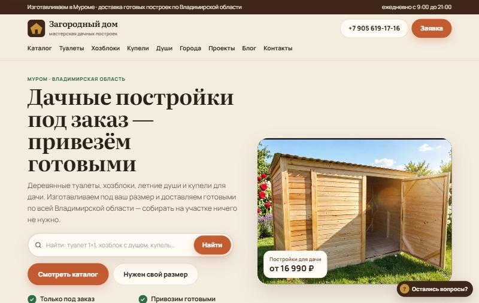
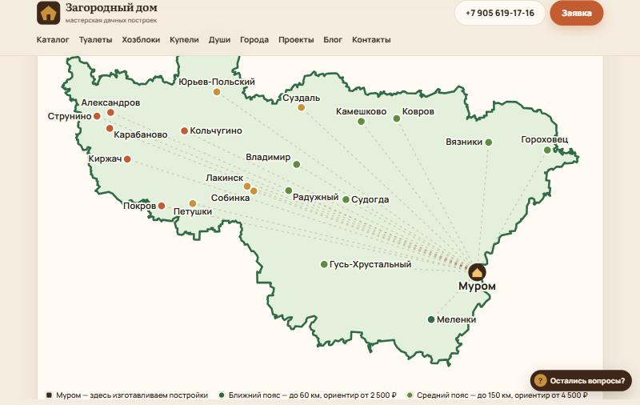
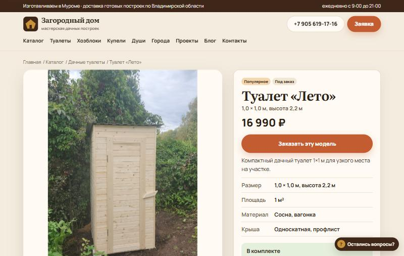

# «Загородный дом» — сайт мастерской дачных построек

Рабочий сайт мастерской из Мурома, которая изготавливает под заказ деревянные дачные туалеты, хозблоки, летние души и купели и доставляет их по Владимирской области.

**Сайт:** [zagorod-dvor.ru](http://zagorod-dvor.ru)



## Что умеет сайт

- **Каталог** из 4 разделов и 16 товаров: карточки с характеристиками, комплектацией и фото.
- **Конструктор цены**: опции товара (материал обшивки, дополнительные окна) пересчитывают цену на лету и попадают в заявку.
- **Поиск с подсказками** на главной и в каталоге: разделы и товары, навигация с клавиатуры, поиск работает и без JavaScript.
- **Блок «С этим покупают»** — подборка из админки или автоматическая из соседних разделов.
- **Отзывы о модели** со звёздами и разметкой рейтинга для поисковиков (только по настоящим отзывам).
- **Заявки** из нескольких форм с защитой от спама (honeypot) и уведомлением на почту.
- **Блог** с простой разметкой: заголовки, списки, ссылки, жирный текст.

## SEO

- 105 посадочных страниц под запросы вида «купить дачный туалет в Муроме»: 21 город × 4 раздела + страницы городов. У каждой — свой текст про дорогу, сроки, грунт и подъезд, а не просто подставленное название.
- Мета-теги генерируются с актуальной ценой: `{цена}` в SEO-полях подставляет минимальную цену раздела.
- Микроразметка schema.org: `Product` + `Offer` (`MadeToOrder`), `AggregateOffer` для городов, `FAQPage`, `BreadcrumbList`, `LocalBusiness`, `Article`.
- `sitemap.xml` и `robots.txt` генерируются из данных, canonical на каждой странице.
- Семантическое ядро и статьи блога под информационные запросы.

## Карта доставки



SVG-карта Владимирской области: контур взят из OpenStreetMap (relation 72197), спроецирован и упрощён скриптом. Города окрашены по поясам доставки от Мурома, каждый ведёт на свою страницу. На телефоне карта листается и сразу открывается на Муроме.



## Технологии

- **PHP 7.4+ без фреймворков** — сайт работает на обычном виртуальном хостинге (Timeweb, Apache + mod_rewrite).
- **Хранение данных в JSON** (`data/db.json`) с блокировкой файла при записи — для каталога такого размера база данных не нужна.
- **Миграции данных** (`app/lib/migrations.php`): разовые обновления живой базы выполняются при первом запросе, не затирая правки владельца.
- **Vanilla JavaScript** без зависимостей: меню, всплывающие формы, поиск, пересчёт цены.
- **CSS** с дизайн-токенами, адаптивная вёрстка от 375 px.

Сначала сайт был написан на Next.js, затем перенесён на PHP, чтобы работать на имеющемся у заказчика виртуальном хостинге без отдельного сервера.

## Структура

```
app/
  bootstrap.php      маршрутизация
  lib/               данные, SEO, компоненты, формы, миграции
  pages/             страницы: главная и каталог, города, информационные
  content/           статьи блога
  cities.json        21 город: расстояния, тексты, координаты
  region-map.json    контур области для SVG-карты
data/db.json         каталог, тексты, настройки (демо-копия без заявок)
public_html/         точка входа, стили, скрипты, фото
```

В репозиторий **не входит админка** (товары, категории, фото с перетаскиванием, выключатель товаров, заявки, настройки) — она остаётся только на рабочем сайте. Из данных удалены заявки покупателей.

## Запуск локально

```bash
php -S 127.0.0.1:8080 -t public_html public_html/index.php
```

Откройте http://127.0.0.1:8080.

## Как делался проект

Сайт разработан с использованием Claude Code (Anthropic): постановка задач, генерация и рефакторинг кода. Решения по архитектуре, проверке страниц в браузере, SEO-текстам, данным и проверке результата — мои.
